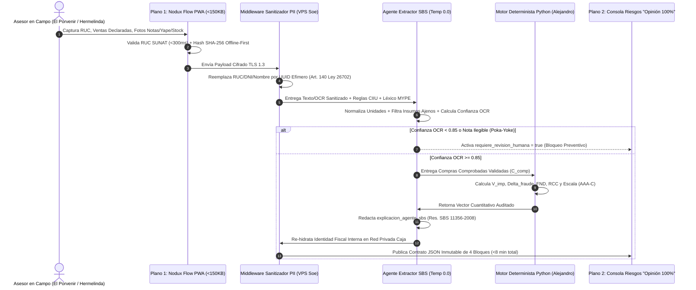

# WASI-RISK AI — Especificación Oficial del Sistema (Spec-Driven Architecture)
**Motor Agéntico Soberano de Triangulación Microfinanciera y Auditoría Pre-Desembolso al 100%**  
**Evento:** Cajathón 2026 — Caja Trujillo (Track de Riesgos)  
**Versión del Contrato:** `v2.4.0-PRODUCTION-READY`  
**Moneda Oficial:** Soles Peruanos (`PEN`, `S/`) con precisión estricta de 2 decimales.

---

## 1. Visión Ejecutiva y Problema de Negocio

En las finanzas microempresariales del norte peruano (polos productivos como **El Porvenir** en calzado y **Mercado La Hermelinda** en comercio mayorista/abarrotes), el **80% de la cartera MYPE** opera bajo informalidad documentaria parcial: cuadernos manuscritos, notas de venta sin valor fiscal, comprobantes térmicos borrosos y transferencias fraccionadas vía billeteras digitales (Yape/Plin).

En el flujo tradicional (**AS-IS**), la Unidad de Riesgos solo logra auditar mediante "Opinión de Riesgos" entre el **8% y 10% de los expedientes** antes del desembolso debido a cuellos de botella operativos (72 horas promedio de ciclo y un costo de S/ 160.00 por evaluación física). El **90% restante** pasa por aprobación delegada con riesgo latente de:
1. **Maquillaje de Ventas por Asesor ("Efecto Viernes 6:00 p. m."):** Inflación deliberada de ventas declaradas para cumplir metas comerciales de colocación de fin de mes.
2. **Incoherencia de Giro CIIU:** Presentación de boletas cruzadas o prestadas de rubros ajenos a la actividad real del solicitante.
3. **Sobreendeudamiento Silencioso:** Cálculo optimista del Flujo Neto Disponible (FND) y del Ratio de Cobertura de Cuota (RCC).

**WASI-RISK AI** transforma el flujo hacia un paradigma **TO-BE de Auditoría Pre-Desembolso al 100% en 8 minutos**, combinando extracción agéntica privada a temperatura `0.0` con un motor matemático determinista homologado a la Resolución SBS N.° 11356-2008.

---

## 2. Gobernanza del Squad e Interfaces Técnicas

### 2.1 Nicolás López — Product Owner, P&L Bancario & Pitch Lead
- **Rol Estratégico:** Dueño del Caso de Negocio bajo rigor **Harvard Business Publishing** y administrador de las reglas paramétricas sectoriales (`data/reglas_parametricas_trujillo.json`).
- **Métricas Base Auditadas (Caja Trujillo):**
  - **Cartera Bruta de Créditos:** `S/ 3,000,000,000.00` (S/ 3,000 Millones).
  - **Concentración MYPE:** `~80.0%` de la cartera activa concentrada en comercio, producción de calzado, manufactura ligera y servicios en polos como El Porvenir, La Hermelinda y Gamarrita Norteña.
  - **Cartera de Alto Riesgo Ajustada (CARA):** `15.10%`.
  - **Impacto Directo en P&L (Provisiones SBS):** Reducción conservadora de **50 puntos básicos (0.50%)** en la transición a categorías Deficiente/Dudoso/Pérdida mediante el bloqueo temprano de expedientes maquillados, liberando **S/ 15,000,000.00 anuales** en gasto de provisiones directas al Estado de Resultados.
  - **Eficiencia Operativa Unitaria:** Reducción del costo operativo por expediente auditado de **S/ 160.00 a S/ 18.00** (-88.75% en OPEX de evaluación) y compresión del *Time-to-Yes* de **72 horas a 8 minutos**.
- **Interfaz de Salida:** Gobierno de umbrales de margen bruto ($\mu_{ciiu}$), rotación mensual ($\rho_{ciiu}$) y estructura tarifaria SaaS B2B Soberano (Año 1: `S/ 142,000` Plan Core a `S/ 320,000` Plan Enterprise Full-Portfolio).

### 2.2 Soe Macero — Compliance SBS & IA Agéntica en VPS Soberano
- **Credenciales de Dominio:** Ex-Gerente Financiera en BanBif y ex-Jefa de Operaciones en Caja Sipán.
- **Rol Técnico y Normativo:** Opera el pipeline de inferencia privada en **VPS Local / Modo Híbrido Sanitizado**, garantizando cumplimiento irrestricto de:
  - **Art. 140° de la Ley N.° 26702 (Ley General del Sistema Financiero):** Protección absoluta del Secreto Bancario y prohibición de exponer PII financiero en nubes públicas no auditadas.
  - **Resolución SBS N.° 504-2021:** Reglamento para la Gestión de la Seguridad de la Información y la Ciberseguridad.
  - **Resolución SBS N.° 11356-2008:** Reglamento para la Evaluación y Clasificación del Deudor y la Exigencia de Provisiones.
- **Principio de Cero Caja Negra:** Los agentes de Soe **JAMÁS aprueban ni rechazan créditos de forma autónoma**. Operan a `temperature = 0.0` exclusivamente como:
  1. **Parser Documental Estructurado:** Extrae ítems, cantidades, unidades informales y precios desde evidencia multimodal (notas de compra manuscritas, tickets térmicos, historial Yape/Plin y actas de conteo de inventario) normalizándolos contra `lexico_unidades_mype.json`.
  2. **Redactor de Sustentación Normativa (`explicacion_agente_sbs`):** Genera el párrafo técnico auditable que explica la triangulación matemática realizada por el motor de Alejandro para el archivo oficial de Auditoría Interna y de la SBS.

### 2.3 Alejandro Flores — Scoring Cuantitativo Determinista & BPMN 2.0
- **Credenciales de Dominio:** Puesto 1 de Ingeniería Industrial (UTP), especialista en modelamiento estocástico/determinista y optimización de procesos bancarios.
- **Rol Técnico:** Propietario del motor matemático en Python/SQL (`engine/motor_scoring_wasi.py`) y del rediseño de procesos en **Bizagi BPMN 2.0**:
  - **Proceso AS-IS:** 72 horas de espera, cuello de botella en analistas senior, muestreo aleatorio del 10% ("Opinión de Riesgos"), alta vulnerabilidad a colusión o maquillaje de fin de mes.
  - **Proceso TO-BE:** 8 minutos extremo a extremo, **100% de cobertura en Auditoría Pre-Desembolso**, segregación automática en 5 carriles de decisión (`AAA`, `AA`, `A`, `B`, `C`).
- **Fórmulas Matemáticas Oficiales del Motor:**
  1. **Ventas Implícitas Mensuales Sustentadas ($V_{imp}$):**
     $$V_{imp} = \left( \frac{C_{comp}}{1 - \mu_{ciiu}} \right) \times \rho_{ciiu}$$
     Donde $C_{comp}$ son las compras mensuales comprobadas y validadas para el giro, $\mu_{ciiu}$ es el margen bruto estándar del CIIU y $\rho_{ciiu}$ es el factor de rotación mensual del capital de trabajo.
  2. **Índice de Desviación Declarativa ($\Delta_{fraude}$):**
     $$\Delta_{fraude} = \frac{V_{decl} - V_{imp}}{V_{imp}}$$
     Mide la brecha porcentual entre lo declarado por el asesor comercial ($V_{decl}$) y la capacidad real de generación de ingresos sustentada por insumos ($V_{imp}$).
  3. **Flujo Neto Disponible Conservador ($FND$):**
     $$FND = \left( \min(V_{decl}, V_{imp}) \times \mu_{ciiu} \right) - G_{op\_fam} - D_{sbs}$$
     El motor utiliza siempre el menor valor entre las ventas declaradas y las ventas implícitas para impedir que la inflación declarativa infle artificialmente la capacidad de pago.
  4. **Ratio de Cobertura de Cuota ($RCC$):**
     $$RCC = \frac{FND}{\text{Cuota Propuesta}}$$

### 2.4 Alexander Miranda — CTO & Tech Lead (Rigor Bancario ZyTrust)
- **Credenciales de Dominio:** Arquitecto de software con experiencia en firma digital, biometría y core transaccional de grado bancario (ZyTrust) y creador del ecosistema *Nodux*.
- **Arquitectura de Dos Planos Conectados:**
  - **Plano 1 — Captura en Campo (Reutilización de *Nodux Flow* PWA `<150 KB`):** Aplicación web progresiva *Mobile-First* y *Offline-First* sobre `IndexedDB` para asesores de negocios en zonas con conectividad intermitente (El Porvenir alto, galerías subterráneas de La Hermelinda). Ejecuta pre-validación de padrón RUC SUNAT en `<300 ms`, compresión local de imágenes con sello criptográfico `SHA-256` y geolocalización anti-suplantación.
  - **Plano 2 — Consola Central de Riesgos "Opinión 100%" (Adaptación de *Nodux Commercial OS*):** Bandeja de comando en tiempo real para el Comité de Riesgos de Caja Trujillo. Recibe el payload JSON de 4 bloques, pinta el semáforo de fraude, aplica recortes automáticos de monto en categoría `A` y bloquea desembolsos en categoría `C`.

---

## 3. Arquitectura de Flujo End-to-End (Diagrama de Secuencia)



---

## 4. Steering Rules Oficiales (Sintaxis EARS — Easy Approach to Requirements Syntax)

Las siguientes reglas gobiernan de manera obligatoria todo el código, prompts y simuladores del repositorio `wasi-risk-core/`:

### 4.1 Regla Ubiquitous (Omnipresente)
> **UBIQUITOUS-01:** El sistema **SIEMPRE** expresará todos los importes monetarios en Soles Peruanos (`PEN`, `S/`) redondeados a dos decimales exactos (`0.00`) y **SIEMPRE** se comunicará entre el Plano 1 (PWA), el VPS de IA (Soe), el Motor Cuantitativo (Alejandro) y el Plano 2 (Consola de Riesgos) mediante el **Contrato JSON Inmutable de 4 Bloques**:
> 1. `expediente_id` y metadatos de trazabilidad (`timestamp_auditoria`, `agencia_origen`, `modo_inferencia`, `hash_integridad_sha256`).
> 2. `validacion_fiscal` (`ruc`, `estado_sunat`, `condicion_domicilio`, `giro_ciiu`, `nombre_giro`, `coherencia_insumos_giro`, `confianza_extraccion_ia`).
> 3. `triangulacion_financiera` (`moneda`, `ventas_declaradas_asesor`, `compras_comprobadas_documentos`, `margen_bruto_ciiu`, `factor_rotacion_mensual`, `inventario_fisico_estimado`, `ventas_implicitas_calculadas`, `delta_desviacion_declarativa`, `flujo_neto_disponible`, `cuota_mensual_propuesta`, `ratio_cobertura_cuota_rcc`).
> 4. `dictamen_riesgos` (`alerta_fraude_maquillaje`, `requiere_revision_humana`, `clasificacion_sbs_proyectada`, `tasa_provision_sbs`, `escala_interna_caja_trujillo`, `accion_operativa`, `monto_solicitado_original`, `monto_maximo_recomendado`, `explicacion_agente_sbs`).

### 4.2 Regla Event-Driven (Dirigida por Eventos)
> **EVENT-01:** **CUANDO** el índice de desviación declarativa (`delta_desviacion_declarativa`) supere el umbral de `0.30` (es decir, cuando las ventas declaradas por el asesor superen en más de un **30.0%** a las ventas implícitas sustentadas por compras comprobadas y rotación de giro), el motor determinista **ACTIVARÁ** automáticamente la bandera booleana `alerta_fraude_maquillaje = true` y degradará el expediente a revisión restrictiva o bloqueo pre-desembolso.

### 4.3 Regla State-Driven (Dirigida por Estado)
> **STATE-01:** **MIENTRAS** el expediente se procese en **Modo Híbrido** (Sanitizador Local en Caja Trujillo + API de Inferencia Rápida de Baja Latencia `<0.8s`), el middleware de perímetro de Soe Macero **DEBE** anonimizar todo dato personal o fiscal identificable (**PII**: RUC, DNI, Razón Social, Nombres de Proveedores, Dirección Domiciliaria y Números de Celular Yape/Plin) reemplazándolo por tokens UUID efímeros (`UUID-EXP-XXXX`) antes de que cualquier paquete abandone la subred local de la Caja, en cumplimiento del Art. 140° de la Ley N.° 26702.

### 4.4 Regla Unwanted Behavior (Comportamiento No Deseado / Poka-Yoke)
> **UNWANTED-01 (Poka-Yoke Documental):** **SI** el nivel de certeza de extracción documental (`confianza_extraccion_ia`) es estrictamente menor a `0.85`, **O SI** la nota manuscrita presenta tachaduras críticas/ilegibilidad, **O SI** los insumos detectados no guardan relación con el `giro_ciiu` declarado (`coherencia_insumos_giro = false`), entonces el agente de Soe Macero **NO** inventará, asumirá ni interpolará montos bajo ninguna circunstancia; en su lugar, **MARCARÁ** obligatoriamente `requiere_revision_humana = true` y asignará acción de retención preventiva para auditoría física.

---

## 5. Estructura Oficial del Repositorio `wasi-risk-core/`

```text
wasi-risk-core/
├── SPEC.md                                  # (Fase 1.1) Fuente Única de la Verdad y Reglas EARS
├── AGENT_SKILL_SOE.md                       # (Fase 1.2) System Prompt Maestro y Reglas de Ingesta SBS
├── data/
│   ├── reglas_parametricas_trujillo.json    # (Fase 2.3) CIIUs Trujillo, Provisiones SBS y Matriz AAA-C
│   ├── lexico_unidades_mype.json            # (Fase 2.4) Normalizador semántico y reglas Poka-Yoke
│   ├── few_shot_golden_cases.json           # (Fase 2.5) 4 Casos Testigo Oficiales con Input/Output exacto
│   └── dataset_50_expedientes_trujillo.json # (Fase 2.6) 50 Expedientes sintéticos generados por el motor
├── engine/
│   └── motor_scoring_wasi.py                # (Fase 2.6) Motor cuantitativo auditable en Python 3 puro
└── wasi_ingestion_command_center.html       # (Fase 3.7) Centro de Comando Ejecutivo (Tema Claro Alto Contraste)
```
